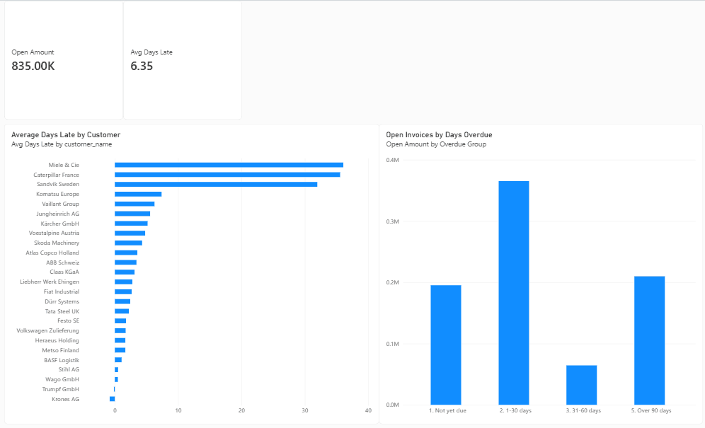
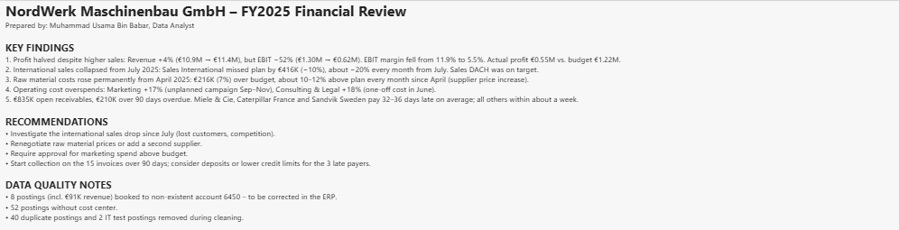

# NordWerk Maschinenbau – Finance Analysis (Python · SQL · Power BI)

End-to-end finance analytics project for a German machine manufacturer (fictional company, realistic ERP data).
Starting point: **6 raw, messy ERP exports** and a task brief from the CFO. Result: **cleaned data, SQL analysis, a 3-page Power BI dashboard and a management summary** for the board meeting.

**Tools:** Python (pandas) · MySQL Workbench · Power BI (DAX, star schema) · Excel

---

## Business questions (from the CFO brief)
1. P&L 2024 vs 2025: Revenue, Gross Margin, EBIT
2. Budget vs Actual 2025: biggest variances and what is behind them
3. Cost center report: which departments missed their budget?
4. Accounts receivable: who pays late, how much is overdue (aging report)?
5. Management dashboard with filters by year, month and cost center

---

## Key findings
| # | Finding |
|---|---|
| 1 | **Profit halved despite higher sales.** Revenue +4% (€10.9M → €11.4M), but EBIT −52% (€1.30M → €0.62M). EBIT margin 11.9% → 5.5%. Actual profit €0.55M vs. budget €1.22M. |
| 2 | **International sales collapsed from July 2025.** Sales International missed plan by €416K (−10%), about −20% every month since July. Sales DACH on target. |
| 3 | **Raw material costs up permanently from April 2025:** €216K (7%) over budget, 10–12% above plan every month (supplier price increase). |
| 4 | **Operating cost overspends:** Marketing +17% (unplanned campaign Sep–Nov), Consulting & Legal +18% (one-off cost in June). |
| 5 | **€835K open receivables, €210K over 90 days overdue.** Miele & Cie, Caterpillar France and Sandvik Sweden pay 32–36 days late on average; all others within about a week. |

**Recommendations:** investigate the international sales drop since July · renegotiate raw material prices or add a second supplier · approval process for marketing spend above budget · collection on 15 invoices > 90 days and deposits/lower credit limits for the 3 late payers.

---

## Dashboard
**Receivables page**



**Management summary page**



Data model: star schema – `gl` and `budget` (facts) connected to `coa`, `cost_centers` and a DAX `Calendar` table, so one Year/Month/Cost-center slicer filters actuals and budget together. `invoices` ↔ `customers` for receivables.

Key DAX measures: `Revenue`, `EBIT`, `EBIT Margin %`, `Budget`, `Actual`, `Variance`, `Variance %`, `Open Amount`, `Avg Days Late`, plus a calculated `Overdue Group` column for aging.

---

## Data cleaning log (general ledger)
| # | Issue found | Action | Rows |
|---|---|---|---|
| 1 | Semicolon separator (German ERP export) | `read_csv(sep=";")` | all |
| 2 | Amounts with German decimal comma, stored as text | `,` → `.`, converted to float | 60 |
| 3 | Three different date formats | parsed each format, combined with `fillna` | all |
| 4 | Lowercase cost centers, vendor names with trailing spaces | `.str.upper()`, `.str.strip()` | ~55 |
| 5 | Postings in USD | converted to EUR at 1.09 | 26 |
| 6 | Duplicate postings (some copies differed slightly) | removed by `journal_id`, kept the copy with a cost center | 40 |
| 7 | IT test postings (±999,999.99) | removed | 2 |
| 8 | Account 6450 not in chart of accounts (incl. €91K revenue) | **flagged**, not changed – to be corrected by accounting | 8 |
| 9 | Missing cost center | filled with `UNASSIGNED` (money kept in totals) | 52 |

Result: 2,225 raw rows → 2,183 clean rows. Budget, invoices and customers were profiled and found clean (47 empty payment dates = unpaid invoices, kept).

**Reconciliation:** P&L totals were checked across Python, SQL and Power BI – all three match to the cent. During the MySQL import, the row-count check revealed that the import wizard had silently dropped the 47 unpaid invoices; the table was reloaded via `pandas.to_sql`.

---

## Repository structure
```
data/raw/        original ERP exports (messy)
data/clean/      cleaned files used for SQL and Power BI
notebooks/       01_data_cleaning.ipynb, 02_analysis.ipynb
sql/             nordwerk_analysis.sql (P&L, budget vs actual, cost centers, AR aging)
powerbi/         NordWerk_Dashboard.pbix
docs/            task brief from the CFO
images/          dashboard screenshots
```

---
*Author: Muhammad Usama Bin Babar · [LinkedIn](https://www.linkedin.com/in/usama-babar-analyst/)*
*The company and data are fictional and were generated for portfolio purposes.*
